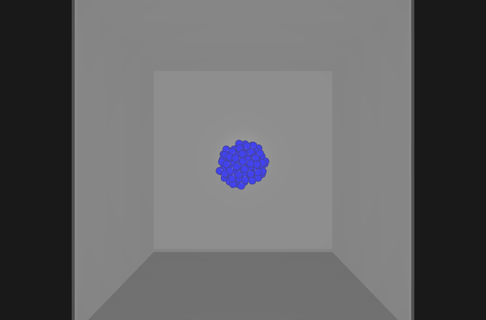
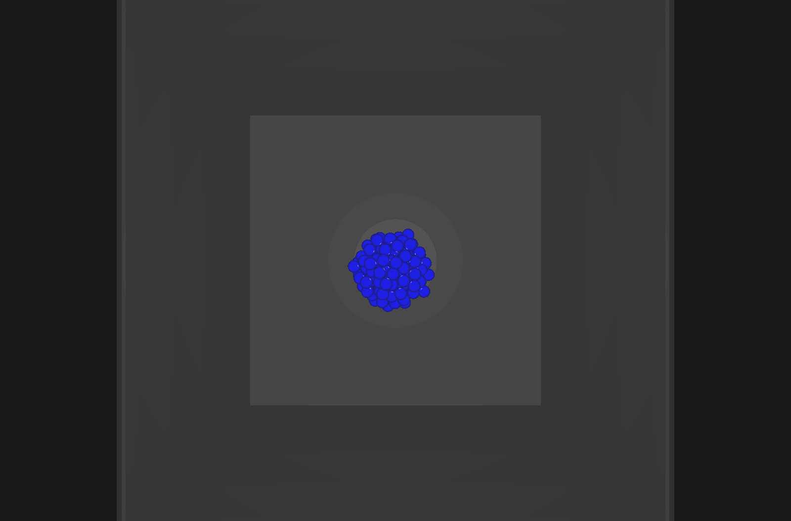
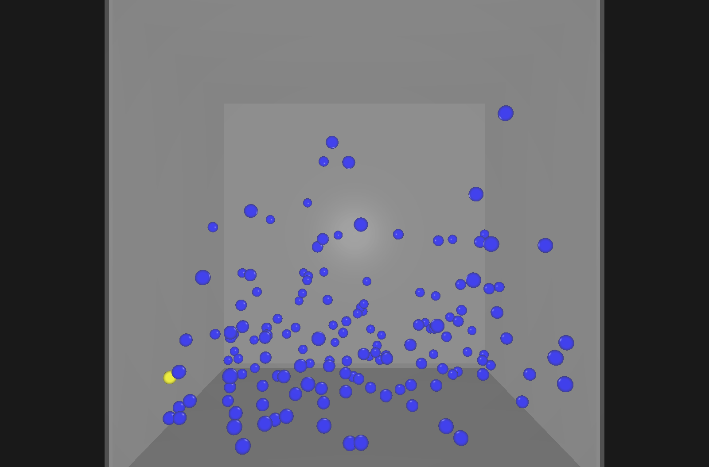
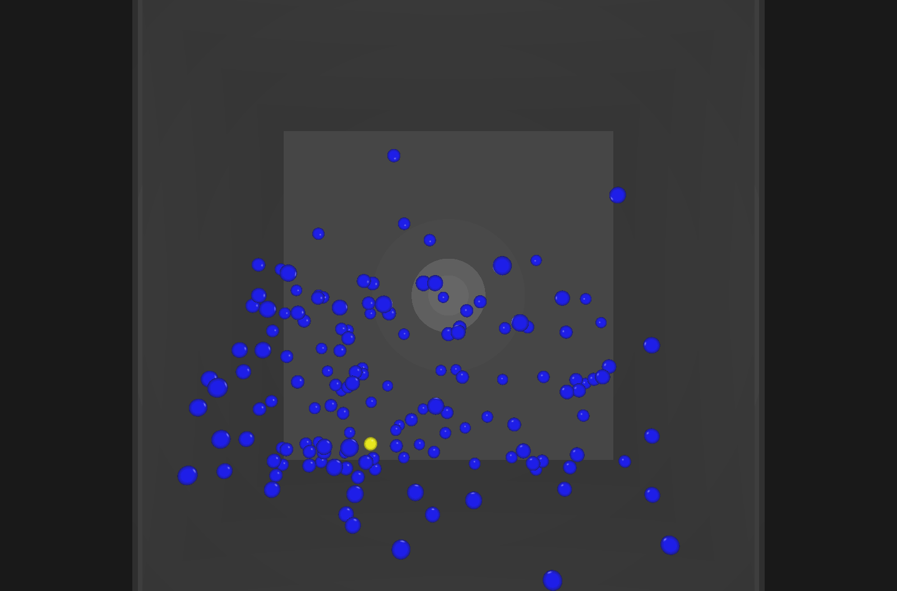

# Physix

Physix is a small, interactive rigid-body physics sandbox: a real-time simulation of colliding spheres in a bounded room, built from scratch in C++ directly on OpenGL rather than on top of an existing physics or game engine. It's meant to be played with, not just watched — select an object, throw it, freeze it, edit its mass/color/velocity, place or remove objects on the fly, and retune the simulation itself (gravity, bounciness, spawn rate) while it's running, all through an on-screen panel.

Under the hood: spheres spawn inside a fixed cuboid room and simulate sphere-sphere and sphere-wall collisions, rendered every frame with a free-fly, mouse-look camera (via GLAD + GLFW, math via GLM). You can click to select a sphere, drag to throw it, freeze it in place, place/remove spheres, edit a selected sphere's properties directly, tune the simulation live (restitution, gravity vs. an orbiting-spring force, spawn rate, wall transparency), and pause/step/reset — all through an in-app debug panel (Dear ImGui), not just recompiling with different literals.

There is no external physics or rendering engine — the simulation (integration, collision detection/resolution, broad-phase spatial partitioning, and a small thread pool) and the renderer are hand-written, organized into focused modules rather than one large file (see [Architecture at a glance](#architecture-at-a-glance)).

## Demo

Central gravity (orbiting-spring acceleration) with low restitution: bodies lose energy on every bounce and settle into a cluster near the room's center.




Uniform (directional) gravity with high restitution: bodies fall and bounce energetically off the floor and each other. One sphere (yellow) is preselected so it's easy to follow through the chaos.




Both were captured with the broad-phase (`UniformGrid`) collision pipeline via [`tools/capture_demo.ps1`](tools/capture_demo.ps1), which drives the engine's own `--screenshot-at`/`--gif` capture flags (see [Benchmark & capture CLI](#benchmark--capture-cli) below) — no external screen-recording tool involved. Re-running the script regenerates them in place under `docs/media/`.

## Performance

See [Benchmark & capture CLI](#benchmark--capture-cli) and [`tools/run_ablation.ps1`](tools/run_ablation.ps1) for how these numbers were produced. Sphere counts below are where steady-state FPS first drops below each threshold, at restitution 1.0, seed 42, comparing the tuned broad-phase collision pipeline (`UniformGrid`) against a naive brute-force O(n²) all-pairs scan — swept adaptively up to 12,000 spheres (each combo's sweep stops once it drops below the lowest threshold, so brute force wasn't run needlessly far past the point it's already broken).

| Gravity mode | Collision mode | Sphere count @ 60fps | @ 30fps | @ 15fps |
|---|---|---|---|---|
| Orbit spring | Broad phase | 1444 | 3856 | 7729 |
| Orbit spring | Brute force | 934 | 1405 | 2083 |
| Uniform gravity | Broad phase | 995 | 4812 | 8743 |
| Uniform gravity | Brute force | 1012 | 1336 | 1878 |

At low-to-moderate counts both collision modes land in a similar range for the 60fps crossing — at that scale, per-sphere rendering and integration cost (both O(n) regardless of collision mode) dominate over collision checking. The gap opens up sharply as sphere count grows: the broad-phase grid sustains roughly 4x as many spheres as brute force before dropping to 15fps (about 7700-8700 vs. about 1900-2100), which is the expected shape for an O(n) neighborhood search against an O(n²) all-pairs scan. Full raw sweep data (all 4 combos, every tested sphere count) is in [`docs/benchmarks/ablation_results.csv`](docs/benchmarks/ablation_results.csv), and the script's own generated summary table is in [`docs/benchmarks/ablation_summary.md`](docs/benchmarks/ablation_summary.md). Absolute FPS numbers depend on the CPU/GPU they were measured on; the broad-phase vs. brute-force *ratio* is the meaningful part.

## Requirements

- Windows
- Visual Studio 2022 (the `v143` toolset)

No package manager is involved — every dependency is vendored under `Dependencies/` and either compiled straight into the project or (GLFW) linked from prebuilt binaries:

| Dependency | Used for | License |
|---|---|---|
| [GLFW](https://www.glfw.org/) (prebuilt `lib-vc2022`, static) | Window, GL context, input | zlib |
| [GLAD](https://github.com/Dav1dde/glad) | OpenGL function loader | generated code (see header) |
| [GLM](https://github.com/g-truc/glm) | Vector/matrix math | MIT |
| [Dear ImGui](https://github.com/ocornut/imgui) v1.92.9 (GLFW + OpenGL3 backends) | In-app debug panel | MIT (`Dependencies/imgui/LICENSE.txt`) |
| [stb_image_write](https://github.com/nothings/stb) v1.16 | PNG screenshots (`--screenshot-at`) | public domain / MIT |
| [gif.h](https://github.com/charlietangora/gif-h) | Animated GIF capture (`--gif`) | public domain |

The only local modifications to vendored code are in Dear ImGui: `imconfig.h` sets `IMGUI_IMPL_OPENGL_LOADER_CUSTOM`, and `imgui_impl_opengl3.cpp` adds one `#include <glad/glad.h>`, so the ImGui backend uses this project's GLAD loader instead of bundling its own.

## Build

Open `Physix.sln` in Visual Studio and build (x64 only — Debug or Release), or from the command line in the repo root:

```
msbuild Physix.sln /p:Configuration=Release /p:Platform=x64
```

The built executable looks for its shader files (`Physix/src/shaders/basic.vert`/`basic.frag`) in a `shaders/` folder next to itself; a post-build step copies them there automatically, so no extra setup is needed after building.

There are no automated tests or lint config in this repo.

## Running it

Run the built `Physix.exe` (in `x64/Debug/` or `x64/Release/` depending on configuration). A window opens showing an empty room; spheres spawn automatically on a timer, fall/orbit under the active acceleration mode, and collide with each other and the walls. A "Physix Debug" panel is always on screen.

**Camera controls:**

| Input | Action |
|---|---|
| `W` / `S` | Move forward / backward |
| `A` / `D` | Strafe left / right |
| `Left Ctrl` | Move up |
| `Left Shift` | Move down |
| `←` / `→` | Look (yaw) left / right |
| `↑` / `↓` | Look (pitch) up / down |
| Hold Right Mouse Button | Capture the cursor and look with the mouse |

**Interacting with the scene** (cursor must be free, i.e. not holding the right mouse button):

| Input | Action |
|---|---|
| Left click a sphere | Select it (selected sphere is highlighted yellow) |
| Left click empty space | Deselect |
| Left click-drag the selected sphere | Throw it — release velocity is proportional to the drag |
| Middle click | Place a new sphere along the camera's aim, and select it |
| `F` | Freeze/unfreeze the selected sphere in place |
| `Delete` | Remove the selected sphere |

**Simulation controls:**

| Key | Action |
|---|---|
| `P` | Pause / resume |
| `N` | Single-step one physics frame (only while paused) |
| `R` | Reset (clears all spheres) |

**The "Physix Debug" panel** exposes, live, no recompile needed:
- Global: pause, restitution, acceleration mode (orbiting spring toward the room's center, or real directional gravity) and its strength/direction, collision mode (tuned broad-phase grid, or a naive brute-force O(n²) scan — see [Performance](#performance)), a tunneling safety factor (how much of a wall's thickness a sphere is allowed to cross in one physics sub-step before its velocity gets clamped — see below), spawn interval/cap, wall transparency (defaults to a semi-transparent 0.2 so the room boundary is visible without hiding what's inside it).
- Per selected object: fixed on/off, mass, color, transparency, and velocity (a numeric alternative to drag-throwing), plus a delete button.

**Tunneling guard:** with no limit on speed, a fast-enough sphere can move farther than a wall's thickness within a single physics sub-step, skipping past the wall-collision check entirely (it only tests the current position, not the path swept since the last one) and passing straight through. `PhysicsWorld` now caps every sphere's velocity each sub-step to at most a configurable fraction (`Tunnel Safety Factor`, default 0.9, i.e. 90%) of the wall thickness divided by that sub-step's actual duration — recomputed live every step (not a fixed constant), so it stays correct even if the frame rate drops, rather than only being safe at whatever frame rate it happened to be tuned for.

## Benchmark & capture CLI

Beyond the interactive app, `Physix.exe` accepts command-line flags for scripted, non-interactive runs — used by the PowerShell scripts in `tools/` (kept out of the C++ project, since they're orchestration, not engine code), but usable directly too:

| Flag | Effect |
|---|---|
| `--hidden` | Create the window without showing it (a real GL context still renders normally) |
| `--benchmark` | Run non-interactively; on exit, print one CSV line: `spheres,restitution,gravity_mode,collision_mode,avg_fps,min_fps,<crossing time per --fps-thresholds entry>` |
| `--spheres=N` | Spawn exactly N spheres immediately (deterministic with `--seed`) instead of the timer-driven spawner |
| `--restitution=F`, `--gravity-mode=orbit\|uniform`, `--gravity=x,y,z`, `--spring=F`, `--collision=broadphase\|bruteforce`, `--tunnel-safety=F` | Same tunables as the debug panel, set up front |
| `--seed=N` | Seed the RNG for reproducible spawn positions/velocities |
| `--duration=S`, `--warmup=S` | Auto-exit after S seconds; exclude the first `warmup` seconds from FPS measurement |
| `--fps-thresholds=a,b,c` | Which smoothed-FPS thresholds `--benchmark` reports first-crossing time for (default `60,30,15`) |
| `--screenshot-at=T@path.png` | Write a PNG of the framebuffer at sim time T (`@`, not `:`, since Windows paths already contain a colon) |
| `--gif=T0@T1@path.gif`, `--gif-fps=N` | Record an animated GIF from sim time T0 to T1 |
| `--track-index=N` | Preselect the Nth spawned sphere (highlighted yellow, same as clicking it) |

Every flag is additive — running `Physix.exe` with none of them is identical to the plain interactive launch.

The two scripts, run from PowerShell (they build Release|x64 first unless given `-SkipBuild`):

| Script | Produces |
|---|---|
| `tools/run_ablation.ps1` | Sphere-count sweep for all 4 gravity × collision combos → `docs/benchmarks/ablation_results.csv` and `ablation_summary.md` |
| `tools/capture_demo.ps1` | The two demo scenarios above → `docs/media/*.png`, `docs/media/*.gif` |

Both call MSBuild at the default Visual Studio 2022 **Community** install path; on another edition, build the solution yourself and pass `-SkipBuild`.

## Architecture at a glance

```
Physix.sln
Dependencies/       vendored third-party code (see Requirements)
Physix/
  Physix.vcxproj
  src/
    Application.cpp   composition root + per-frame loop + CLI parsing (ParseArgs/RunConfig)
    core/             Window, Input, DebugUI (Dear ImGui lifecycle), FrameStats (smoothed FPS), Capture (PNG/GIF)
    physics/          RigidBody, PhysicsWorld (AccelerationMode, CollisionMode), JobSystem, collision/BroadPhase (UniformGrid)
    render/           RenderComponent
    scene/            Scene, SphereSpawner
    interaction/      Picker (click-to-select ray casting), Selection, VelocityTool (drag-to-throw)
    sphere.*, cuboid.*, *_mesh.*, camera.*, shader.*   the remaining per-entity/per-resource classes
    shaders/          basic.vert, basic.frag (Phong lighting)
tools/              run_ablation.ps1, capture_demo.ps1 -- orchestration scripts that drive
                    Physix.exe's CLI to produce the Performance numbers and Demo assets above
docs/
  media/            demo screenshots/GIFs embedded above
  benchmarks/       raw ablation sweep data + generated summary
```

A `Sphere` pairs a `RigidBody` (physics: mass, position, velocity, collision) with a `RenderComponent` (mesh, color, transparency) — the two have no knowledge of each other, so physics can run (and in principle be tested) without a GL context. `PhysicsWorld` sub-steps each frame: a uniform spatial grid narrows sphere-sphere collision checks down from every-pair to nearby-only before resolving them, then wall-collision and integration run in parallel across a small persistent thread pool (`JobSystem`). Every `RigidBody` carries a stable id (assigned at spawn), which is what makes selection, freezing, and velocity-imbuing possible without depending on unstable pointers or vector indices.

Sphere-sphere resolution currently runs single-threaded: resolving a pair mutates *both* bodies, so splitting it across threads by index range would race (an earlier threaded version did exactly that, and was fixed by moving this step back to one thread). Wall collision and integration only touch each sphere's own state plus read-only wall data, so those are the parts parallelized. Each source file's header comment explains the reasoning behind its piece of the design.
